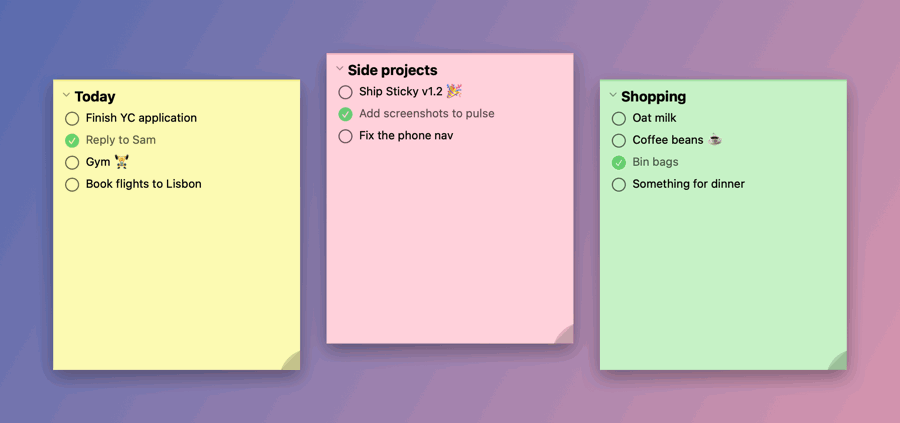
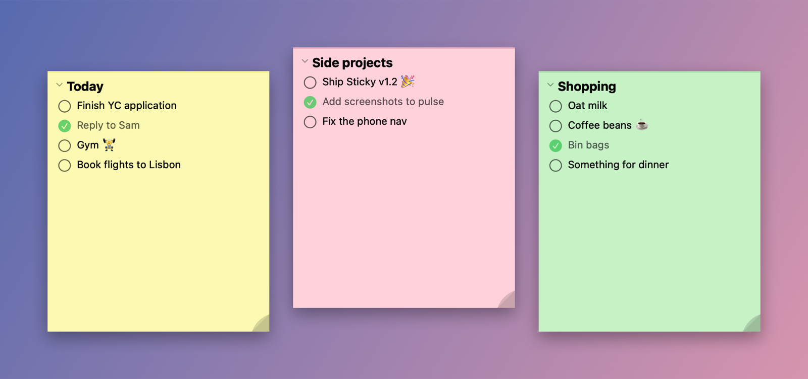

# Sticky

Sticky notes for your Mac desktop, each with its own to-do list. Tick something off and you get confetti. That's basically it.

  



---

## Download

Grab **Sticky.zip** from the [latest release](https://github.com/harit-gillar/Sticky/releases/latest). Unzip it and drag **Sticky.app** into Applications.

> First launch: right-click → Open to get past Gatekeeper. The app isn't signed, so macOS will moan about it.

---

## Features



### The basics
- As many floating stickies as you want, each with its own tasks and colour
- They stay exactly where you left them between launches
- Right-click anywhere on a sticky to open its settings
- Duplicate a sticky from its settings menu
- `⌘N` for a new sticky, `⇧⌘O` to lay them all out side by side
- `⌥⇧S` to hide or show every sticky, from anywhere on your Mac

### Tasks
- `Enter` adds a task and drops you straight into the next one
- `⇧Enter` for a line break, for the longer to-dos
- `⌘Enter` or the checkbox to tick it off
- `Backspace` on an empty task deletes it
- Drag to reorder
- Optionally sink finished tasks to the bottom
- Long tasks wrap instead of getting cut off

### Minimise
Click the chevron next to the title and the sticky shrinks to a slim 36px bar. Click it again to bring it back.

### Confetti
Five styles:
- **Classic** — streaming rectangles, the original
- **Burst** — everything explodes out from one point
- **Stars** — little five-pointed stars
- **Emoji** — 🎉✨🌟💫 pop up, float, fade
- **Minimal** — a few big pieces drifting down, barely there

Every style responds to the Size, Amount, Gravity and Colour settings. Amount goes up to **MAX**, which is 3,000+ pieces. It will lag. That's the point.

### Sounds
Confetti, Yay, Yippie, Cat Laugh, Apple Pay, Rizz or Click Nice. Or import your own MP3, or switch sound off entirely.

### Per-sticky settings
Every sticky gets its own:
- Colour (6 presets, or pick any colour you like)
- Sound
- Confetti style, size, amount, gravity, volume and colour
- Always on top toggle

---

## Add tasks without opening Sticky

Sticky has a `sticky://` URL scheme, so you can throw tasks at it from your launcher:

- **Raycast**: type "Add Sticky Task", pick a sticky, type the task. Setup is in [`raycast-sticky`](raycast-sticky).
- **Alfred**: type `sticky buy milk` and pick which sticky it goes on. Needs the Powerpack. Grab `Sticky.alfredworkflow` from the [latest release](https://github.com/harit-gillar/Sticky/releases/latest) and double-click it, or see [`alfred-sticky`](alfred-sticky).

Either way, the task lands and that sticky jumps to the front.

### Zapier
Paste a webhook URL into Settings → Zapier Integration and every ticked-off task gets sent there, so it can carry on to Notion, Slack, Google Sheets, Todoist or wherever.

---

## Keyboard shortcuts

| Shortcut | Action |
|---|---|
| `⌘N` | New sticky |
| `⇧⌘O` | Open all stickies side by side |
| `⌥⇧S` | Show / hide all stickies |
| `Enter` | New task |
| `⇧Enter` | Line break inside a task |
| `⌘Enter` | Tick a task off |
| `Backspace` | Delete an empty task |
| `⌘Q` | Quit |

---

## Building from source

You'll need Xcode 15+ and macOS 14+. There are no third-party dependencies.

```bash
git clone https://github.com/harit-gillar/Sticky.git
cd Sticky
mkdir -p "Sticky/Preview Content"   # Xcode expects it, git doesn't keep empty folders
open Sticky.xcodeproj
```

Hit `⌘R` to build and run.

There's also an early iPhone version in the project, and CloudKit sync code switched off behind a flag. Neither is finished, so don't expect much from them yet.

---

## Tech

Swift + SwiftUI, SpriteKit for the confetti, AVFoundation for the sounds, and plain JSON on disk (written atomically) for your notes.

---

## Licence

MIT. Do what you like with it.
